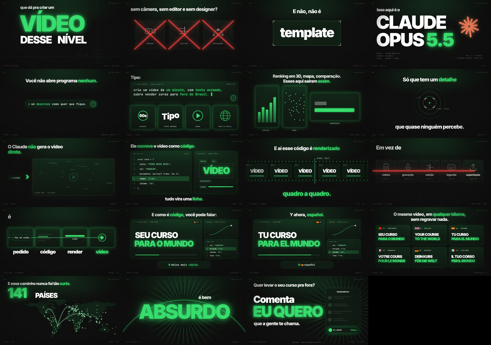

# Vídeo Motion

Skill para o Claude Code que cria **vídeos de motion design escritos em código**.

Você descreve o vídeo. O Claude escreve o roteiro, monta as cenas e entrega o MP4, na horizontal e na vertical (Reels, Shorts, TikTok). Sem abrir editor de vídeo.



Por [Maurício Magnavita](https://www.instagram.com/mauriciomagnavitarocha/) · [Exos Marketing](https://www.instagram.com/exosmkt/)

## O que é uma skill

Um pacote de instruções que ensina o Claude a fazer uma tarefa do jeito certo. Esta ensina a fazer vídeo motion: texto animado no ritmo da voz, cartões, números, mapa, tudo renderizado quadro a quadro.

## Do que você precisa

- [Claude Code](https://claude.com/claude-code) no computador (Mac, Linux ou Windows com WSL)
- [Node.js](https://nodejs.org) 18 ou mais novo
- [ffmpeg](https://ffmpeg.org)
- Python 3 (já vem no Mac e no Linux)

Não sabe se tem? Depois de instalar a skill, peça ao Claude Code: *"confere se eu tenho node, ffmpeg e python instalados e me ajuda a instalar o que faltar"*.

## Como instalar

**Jeito mais fácil.** Abra o Claude Code e cole:

```
Instala esta skill na minha pasta de skills (~/.claude/skills/video-motion):
https://github.com/Exos-Marketing/video-motion
```

**Pelo terminal.**

```bash
git clone https://github.com/Exos-Marketing/video-motion ~/.claude/skills/video-motion
```

**Baixando o arquivo.** [Baixe o zip](https://github.com/Exos-Marketing/video-motion/releases/latest/download/video-motion.zip), descompacte e mova a pasta `video-motion` para dentro de `~/.claude/skills/` (no Windows, `C:\Users\SEU-USUARIO\.claude\skills\`).

Depois, feche e abra o Claude Code.

## Como usar

Abra o Claude Code numa pasta sua e escreva o pedido. Quanto mais você disser, melhor sai:

```
Cria um vídeo motion de 45 segundos, na vertical, para o Instagram.
Tema: [sobre o que é o vídeo e para quem].
No fim, a pessoa deve [comentar a palavra X / clicar no link / me seguir].
Cor da marca: #FF6A00. Assina com @seuperfil.
Sem narração por enquanto.
```

O Claude mostra o roteiro antes de montar. Você lê, ajusta e aprova. Depois ele monta as cenas, mostra uma prévia em imagem e só então gera o vídeo.

Para ver a skill funcionando antes de criar o seu: *"renderiza o vídeo de exemplo da skill video-motion na vertical"*.

## Narração

- **Sua voz:** grave no celular lendo o roteiro e mande o arquivo para o Claude.
- **Voz gerada por IA:** gere na ferramenta que preferir e mande os arquivos.
- **Sem voz:** o vídeo sai mudo e você põe a música no próprio Instagram.

Com voz, o Claude sincroniza cada palavra da tela com a fala. Na primeira vez ele pede para instalar um programa gratuito de transcrição.

## O que esperar

- O primeiro vídeo demora mais: o Claude instala as ferramentas (uns 150 MB) e você ainda está pegando o jeito de pedir.
- Gerar o arquivo final leva alguns minutos por formato.
- É motion gráfico: texto, formas, números, ícones, mapa. Não cria pessoas nem cenas filmadas.
- O vídeo de exemplo é uma peça real da Exos. Serve de modelo. O texto, os números e a assinatura do seu vídeo precisam ser os seus.
- Se usar voz gerada por IA, marque o rótulo de conteúdo feito com IA na hora de postar.

## Deu problema?

Cole a mensagem de erro no próprio Claude Code e peça para ele resolver. Quase sempre é uma ferramenta que falta instalar.

Fez um vídeo com a skill? Marca [@mauriciomagnavitarocha](https://www.instagram.com/mauriciomagnavitarocha/) que eu quero ver.

## Créditos e licença

Motor e instruções: Maurício Magnavita / Exos Marketing. Uso livre para criar os seus vídeos, inclusive comerciais. Não revenda a skill.

Fontes Inter e JetBrains Mono, sob a SIL Open Font License 1.1 (texto em `assets/engine/assets/LICENCAS.txt`).
